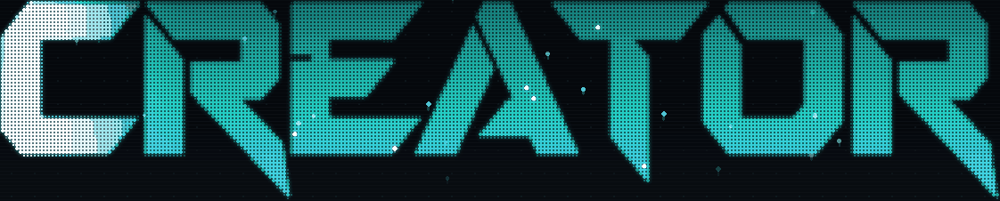
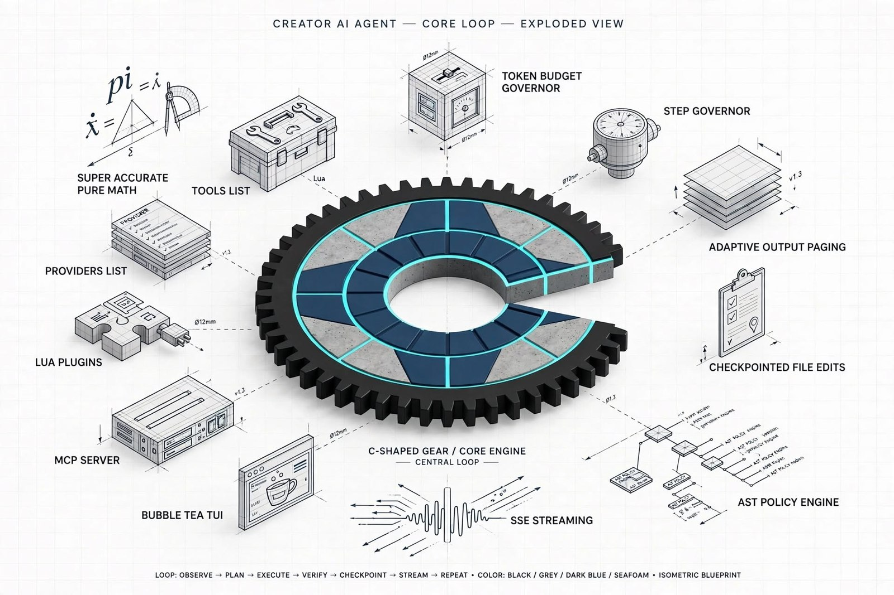
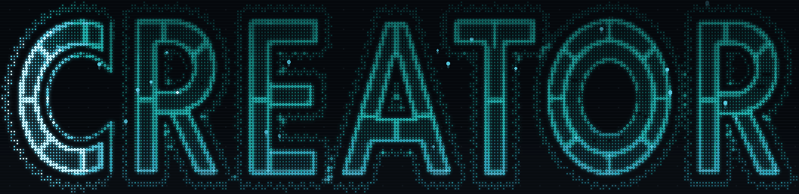
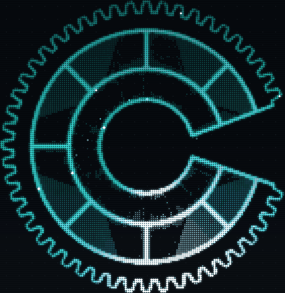
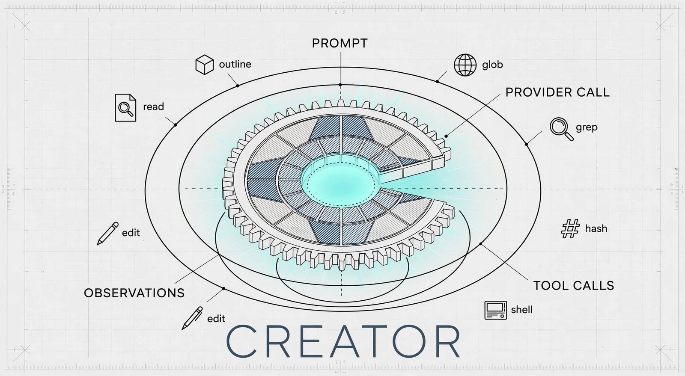

# Creator

<p align="center">
  <picture>
    <source media="(prefers-reduced-motion: reduce) and (prefers-color-scheme: light)" srcset="docs/assets/creator-scifi-light.png">
    <source media="(prefers-reduced-motion: reduce)" srcset="docs/assets/creator-banner-ascii.png">
    
  </picture>
</p>

<p align="center">
  <a href="https://github.com/DERYK-RYLOY/creator/actions/workflows/ci.yml"></a>
  <a href="https://github.com/DERYK-RYLOY/creator/releases"></a>
  
  <a href="LICENSE"></a>
  <a href="https://goreportcard.com/report/github.com/DERYK-RYLOY/creator"></a>
</p>

A terminal agent that never floods its own context.

This tree ships three binaries: **`creator`**, the terminal-first IDE/agent,
**`creator-tui`**, the explicit full-screen entrypoint, and **`ctr`**, the short alias.
Bare `creator` in an interactive terminal opens mission control; in non-interactive
shells it prints usage. `creator run ...` stays the scriptable headless form.

## What Creator does

- `creator` or `creator tui` - mission control: a full-screen terminal IDE with
  a welcome hero, a fuzzy command palette (35 commands, frecency-first), an
  in-transcript search (`CTRL+F`), 35 one-keystroke highlight lenses that filter
  and light up what matters in the conversation, transcript, panels, policy
  cycling and queued messages while the agent runs.
- `creator run "..."` — a headless agent that reads files, runs commands, edits
  code and verifies its work.
- `creator shell "..."` — the same policy-checked job runner, with no model.
- `creator mcp` — the same toolset served over MCP on stdio.
- **Digest + handle** — no raw command output ever reaches the model. Output is
  stored as an artifact and returned as a small digest with a handle you can
  page with `out`.
- **Delegation** — the agent can fork isolated sub-agents with fresh contexts.
  Named profiles (`explorer`, `planner`, `reviewer`, `editor`) curate toolsets.
- **Task board** — persistent, verification-gated planning with dependencies and
  receipts.
- **Knowledge files** — `AGENTS.md`, `CLAUDE.md`, `CREATOR.md` and
  `.creator/knowledge.md` are loaded into the system prompt.
- **Lua plugins and hooks** — extend tools and intercept tool calls. Workspace
  plugins are opt-in; see [Lua plugins](#lua-plugins).

It works with OpenAI, Anthropic, Gemini, xAI, DeepSeek, Mistral, Groq,
OpenRouter, Pollinations Free, Pollinations Pollen, Together, Fireworks, Cerebras, Perplexity, Moonshot, Z.ai, and local
models through Ollama, LM Studio or vLLM.

## Why it exists

Most CLI agents push huge tool output into the model context and the model
drowns. Creator inverts that:

```
job j_01h9x2 · success · exit 0 · 312ms · 8.4MB
×300  pkg/a.go:12: cannot use value (variable of type int) as string
×41   pkg/b.go:9: undefined: helper
… last lines:
FAIL github.com/acme/app [build failed]
[handle=j_01h9x2 · 38 of 91240 lines shown · page with out(handle=..., mode="grep", pattern="...")]
```

The model decides what to look at next. Detail is pulled on demand instead of
pushed by default.

<p align="center">
  
</p>

<p align="center"><sub>The whole system on one sheet — the C-shaped gear is the engine; every subsystem orbits it.</sub></p>

## Install

The short way — one line, no Go required, no admin rights:

**macOS / Linux**

```bash
curl -fsSL https://raw.githubusercontent.com/DERYK-RYLOY/creator/main/install.sh | sh
```

**Windows (PowerShell)**

```powershell
irm https://raw.githubusercontent.com/DERYK-RYLOY/creator/main/install.ps1 | iex
```

Both installers are idempotent: they detect your OS/arch, download the release
archive (building from source instead when there is no release yet), verify its
SHA-256 against `checksums.txt`, put `creator`, `creator-tui` and `ctr` on your
user PATH (`~/.local/bin` on Unix, `%LOCALAPPDATA%\Programs\Creator` on Windows),
add a Start Menu shortcut on Windows, and leave you ready to type `creator`.

With Go 1.27+ (no CGO):

```bash
go install github.com/DERYK-RYLOY/creator/cmd/creator@latest
go install github.com/DERYK-RYLOY/creator/cmd/creator-tui@latest
go install github.com/DERYK-RYLOY/creator/cmd/ctr@latest
```

From a checkout:

```bash
git clone https://github.com/DERYK-RYLOY/creator && cd creator
go build -trimpath -ldflags "-s -w" -o bin/creator ./cmd/creator
creator install        # builds the trio, adds the bin directory to your PATH
```

On Windows, name the outputs `creator.exe`, `creator-tui.exe` and `ctr.exe`.

`creator install` builds `creator`, `creator-tui` and `ctr` into `~/.local/bin`
(override with `--dir`). Run it from a checkout of this repository:

```bash
creator init
export ANTHROPIC_API_KEY=...                  # or OPENAI_API_KEY, GEMINI_API_KEY, ...
export POLLINATIONS_API_KEY=sk_...             # Pollinations Pollen only; the free `pollinations` provider needs no key
creator run "why is the build failing?"
creator run --provider ollama --model qwen3-coder "add tests for internal/reduce"
creator run --continue "now fix the bug you found"
creator mcp | jq .
```

## Commands

| Command | Purpose |
| --- | --- |
| `creator` / `creator tui [flags]` | Open mission control, the full-screen terminal IDE. |
| `creator run [flags] "prompt"` | One headless agent turn. Prompt may come from stdin. |
| `creator shell [flags] <command>` | Run one command through policy and digest, no model. |
| `creator jobs [id]` | List jobs or inspect one, with a tail of its output. |
| `creator out <handle>` | Page stored output: `--grep`, `--range 10:40`, `--tail 50`, `--head 50`, `--full`. |
| `creator mcp` | MCP server on stdio (tools only; resource/prompt lists are empty). |
| `creator providers` | Every backend, its protocol, models and whether it has credentials. |
| `creator sessions` | Recent sessions; resume with `--session <id>` or `--continue`. |
| `creator delegates [id]` | List delegates, inspect one, or follow the live event journal. |
| `creator profiles` | List the delegate agent profiles. |
| `creator knowledge [--print]` | Show the repository instruction files the agent loads. |
| `creator tasks [id]` | The task board: plan, tick with evidence, flags, blockers. |
| `creator revert <checkpoint>` | Restore a file from a checkpoint Creator took before editing it. |
| `creator plugins` | List loaded Lua plugin files, the tools they add and the untrusted workspace directory, if any. |
| `creator connect <provider> <key>` | Verify a key, save it in the user credential store, and select the provider. |
| `creator init` | Write `~/.creator/config.json`. |
| `creator version` | Print the version. |

Useful flags: `--provider`, `--model`, `--base-url`, `--api-key`, `--policy
strict|balanced|yolo`, `--allow-critical`, `--output-tokens`, `--max-steps`,
`--budget`, `--json`, `--session`, `--continue`, `--no-stream`, `--thinking
<tokens>`, `--shell`, `--data-dir`, `--workspace-plugins`.

The registry also exposes read-only triage helpers used for incident response
and code archaeology: `outline`, `read_symbol`, `search_files`, `diff`,
`review`, `tree`, `todos`, `find_def`, `repo_stats`, `hash`, `strings`, `hexdump`, `entropy`, `pe_info`, `elf_info`,
`xor_decode`, `rot13`, `hex_to_ascii`, `base64_decode` and `caesar_shift`.
`net_fetch` and `web_fetch` fetch http(s) URLs and refuse loopback/private
targets unless `CREATOR_ALLOW_PRIVATE_NET=1`, which you should set only for
trusted internal networks.

<p align="center">
  <picture>
    <source media="(prefers-reduced-motion: reduce)" srcset="docs/assets/creator-gear-ascii.png">
    
  </picture>
</p>

## Mission control

Mission control is the terminal IDE form. It launches the same `creator run --json`
engine as a child process and renders its NDJSON event stream: thinking, assistant
deltas, tool starts/ends, usage, notices, final result and session id.

```bash
creator                         # in an interactive terminal
creator tui                     # explicit entrypoint
creator tui --provider ollama --model qwen3-coder
creator tui --policy bypass     # or manual / accept edits
```

Keys:

| Key | Action |
| --- | --- |
| `ENTER` | Transmit the mission |
| `ALT+ENTER` / `CTRL+J` | Newline |
| `ESC` | Interrupt the running mission, or clear the prompt |
| `CTRL+C` | Quit and stop the running mission |
| `CTRL+Y` | Copy the full transcript |
| `CTRL+F` | Search the conversation (`enter` next, `alt+enter`/`up` previous, `pgup`/`pgdn` jump 5, `esc` clears then closes) |
| `CTRL+G` / `ALT+G` | Cycle the 35 highlight lenses forward / backward |
| `SHIFT+TAB` | Cycle manual permissions → accept edits → bypass permissions |
| `CTRL+P` / `F1` | Command palette (35 commands, fuzzy + frecency) |
| `CTRL+R` | Session history (`/sessions`) |
| `PGUP` / `PGDN` | Scroll a page of the transcript |
| `CTRL+U` / `CTRL+D` | Scroll a half page |
| `UP` / `DOWN` | Scroll one line |
| `HOME` / `END` | Jump to the top / the live tail |
| `CTRL+UP` / `CTRL+DOWN` | Prompt history |
| `CTRL+O` | Expand/collapse the latest tool/output box |
| `TAB` | Expand/collapse the latest tool/output box |
| `CTRL+B` | Toggle the right sidebar (session - model - workspace - lens - keys) |
| Drag with left mouse button | Select text and copy it |

Slash commands worth knowing (all 35 live in the F1 palette): `/search` finds text in the conversation, `/lens [name|off]` pins one of the 35 highlight lenses (or cycles with `ctrl+g`, `/lens-off` to disable), `/sessions` opens the session list, `/session <id>` resumes one, `/continue` resumes the most recent one, `/new` starts fresh, `/todo` opens the session checklist, `/copy` / `/copy-last` / `/copy-code` copy the transcript, the last reply or the last code block, `/export` saves the transcript as markdown under `~/.creator/exports/`, `/usage` shows last-run tokens, `/stats` shows transcript statistics, `/expand-all` / `/collapse-all` fold every box, `/keys` opens the keyboard cheatsheet overlay, `/theme` browses the built-in themes, `/models` shows the connected providers' working free models, and `/quit` leaves mission control. Drag with the left mouse button selects and copies any visible transcript section; left-clicking a tool/output box without dragging expands or collapses it.

**Find and lenses.** `CTRL+F` opens the find bar inside the transcript: matches light up inline, the bar shows a live `n/N` counter, `enter` jumps to the next match (wrapping), `alt+enter`/`up` the previous one, `pgup`/`pgdn` skip five at a time, `esc` first clears the query then closes the bar. Lenses go one step further: `CTRL+G` cycles 35 built-in filters — `errors`, `warnings`, `security`, `secrets`, `todos`, `risk`, `important`, `urls`, `envvars`, `breaking` and friends — that both filter the feed (blocks without matches collapse away; the user's turns and live work in flight always stay) and highlight the matched words in the lens color. The active lens shows in the sidebar with its hit count and can be pinned by slug with `/lens errors` or disabled with `/lens-off`.

The screen is a near-black, professional conversation surface. A one-line header carries the Creator wordmark on the left and the git branch plus provider/model on the right; the body splits into the transcript and an optional right sidebar (session state, model, workspace, active lens, key map - auto-shown at 120+ columns, toggled with CTRL+B). User turns render with an accent spine; assistant replies are plain text; tool work renders as bordered boxes whose hairline warms to amber while running and cools to quiet on completion. The composer is a bordered input box that warms to the accent color while the agent works. The status bar underneath carries the permission-mode chip and, when a lens is active, the lens chip (hits/hidden) on the left, and live run telemetry on the right - elapsed time, current tool, token and tool counters.

**The CREATOR wordmark animation.** The signature wordmark is a volumetric dot field baked into the binary and rendered as Unicode braille patterns - no assets, no goroutines, pure functions of a tick-driven clock. The master cutout is downscaled to the terminal lattice and every dot carries a pseudo-depth plane, so energy fronts sweep *through* the volume rather than over a decal. The motion model: layered-sine depth parallax, a smooth-vector idle drift with an outward-breathing tide, pow-sharpened caustic light filaments, heartbeat energy fronts with spring displacement and a tangential swirl, an alternating comet glare that white-heats the dots it crosses, exponential sparkle flares and rising bubbles with fading wakes. The palette rides the active theme (muted to thinking to foreground to accent, with a molten near-white tip), ping-ponged through a gamma curve so crests detonate instead of washing out. An idle empty session shows the full-size hero wordmark above the composer; once the transcript fills, the hero condenses to the animated corner widget in the status bar right edge.

<p align="center">
  <picture>
    <source media="(prefers-reduced-motion: reduce)" srcset="docs/assets/creator-logo-ascii.png">
    
  </picture>
  <br>
  <sub>The gear C — the same dot-field engine, one revolution per breath.</sub>
</p>

## How it works

<p align="center">
  
</p>

**Digest + handle.** Output is classified (search results, file listings,
diffs, build logs, free text) and summarized to a token budget. Head and tail
are always kept, repeated lines are collapsed, and diagnostics are clustered by
normalized message. Everything is addressable via `out`.

**Nothing blocks.** `shell` runs as a tracked job with a timeout and a
process-tree kill. Set `background: true` and the agent gets a job id back
immediately, keeps working, and polls with `jobs`. Backgrounded jobs are not
auto-killed unless you pass a timeout.

**Commands are parsed, not pattern-matched.** Every command goes through a real
bash AST (`mvdan.cc/sh`). Pipelines into interpreters, dynamic command names,
fork bombs, destructive redirections, `rm -rf` of root paths, dynamic destructive
targets, encoded PowerShell and privilege escalation are classified as *safe*,
*moderate* or *critical*. `balanced` (default) runs safe and moderate, refuses
critical; `strict` confirms anything that is not read-only; `yolo` runs
everything. Non-interactive sessions refuse rather than guess.

**Shell has no filesystem confinement.** The structured file tools are confined
to the workspace (including symlink resolution). The shell tool is a normal OS
shell as your user; run Creator under a dedicated user or VM for untrusted
repositories and use `--policy strict`.

**Sessions are journals.** Transcripts, token usage and job records live in
bbolt. `--continue` picks up the last session with full history.

**Every mutation is reversible.** `write`, `edit`, `append`, `insert`, `patch`,
`write_file` and `revert` take a checkpoint of the previous file first. Checkpoint
ids are exact or uniquely-prefixed; ambiguous prefixes are refused.

## Delegation

The `delegate` tool forks a real agent loop into an isolated sub-agent: fresh
conversation, its own toolset (filterable), its own token budget and its own
session record in bbolt. When it finishes, the delegator pays only for a reduced
report; the sub-agent's raw reads and command output never enter the parent
context.

Delegates may spawn further delegates (`can_spawn`, depth-limited), run
concurrently (capped; the rest queue), override provider/model for cheap
surveys, and every state change is persisted as an ordered event journal:

- `delegates` lists or waits (`wait_seconds`), `delegate_cancel` stops one.
- `creator delegates` works cross-process — records and journal survive the
  run; delegates whose owner process is gone are marked orphaned.
- `creator delegates --events 50 --follow` replays and live-tails the journal.

Limits live in config: `delegate_concurrency` (default 8), `max_delegate_depth`
(2), `delegate_max_per_root` (64), `delegate_max_steps` (24),
`delegate_output_tokens` (300).

### Agent profiles

| Profile | Access | Default toolset |
| --- | --- | --- |
| `explorer` | read-only | read/list/glob/grep/outline/read_symbol/search_files/hash/strings/out/jobs |
| `planner` | read-only | inspect + diff/review; returns an ordered plan, no edits |
| `reviewer` | read-only | inspect + diff/review; findings must cite file:line |
| `editor` | write | inherits the delegator's tools; implements and verifies |

Profiles are enforced, not suggested: the registry predicate removes tools the
profile does not allow, and an explicit `tools` list only narrows a profile
further. `creator profiles` prints the table above from the live registry.

## Knowledge files

Creator reads repository instructions before acting. On every run it looks for:

```
AGENTS.md
CLAUDE.md
CREATOR.md
.creator/knowledge.md
```

Each file is capped at 8 KiB and the section at 24 KiB; content is clipped at a
line boundary and the agent is told it was truncated. Only the workspace root is
scanned. Set `CREATOR_NO_KNOWLEDGE=1` (or `"disable_knowledge": true`) to turn
the feature off.

## Task board

The `tasks` tool is a persistent, verification-gated board the agent plans on:

- **The completion oracle.** A task whose `verify` command was set closes only
  when that command runs and exits 0; the job id is attached as a receipt.
- **Dependency graph.** `depends_on` makes a dependent task unstartable and
  unclosable until dependencies finish. Cycles are refused.
- **Single focus.** Exactly one task may be `in_progress` unless `force:true` is
  passed and recorded.
- **Reversible.** Every mutating tool snapshots the previous file; `creator
  revert <id>` puts it back.

## Lua hooks

Hooks intercept tool calls and delegations in load order. Each hook may inspect,
rewrite or refuse:

```lua
hook{
  on = "before_tool", name = "shell",
  handler = function(ev)
    if string.find(ev.args.command, "hosts", 1, true) then
      return { deny = true, reason = "hosts file is off limits" }
    end
  end,
}
```

Supported points: `before_tool`, `after_tool`, `before_delegate`,
`after_delegate`. The sandbox is unchanged: base/string/table/math only.

## Lua plugins

Plugin tools are registered into the same registry as built-in tools. Drop a
`.lua` file in `~/.creator/plugins/` (user plugins; always loaded) or in
`<workspace>/.creator/plugins/` **only after opting in**:

```bash
creator run --workspace-plugins "..."
# or
CREATOR_WORKSPACE_PLUGINS=1 creator run "..."
```

Workspace plugins are untrusted code: a repository must not gain code execution
merely by being opened. Without the opt-in, Creator prints that it is ignoring
the workspace plugin directory and continues.

## Configuration

`~/.creator/config.json` (written by `creator init`), overridden by environment
then flags:

```json
{
  "provider": "anthropic",
  "model": "claude-sonnet-4-5",
  "max_tokens": 4096,
  "stream": true,
  "output_tokens": 0,
  "max_steps": 40,
  "policy_mode": "balanced",
  "shell": "auto"
}
```

Environment: `CREATOR_PROVIDER`, `CREATOR_MODEL`, `CREATOR_BASE_URL`,
`CREATOR_API_KEY`, `CREATOR_POLICY`, `CREATOR_SHELL`, `CREATOR_OUTPUT_TOKENS`,
`CREATOR_MAX_TOKENS`, `CREATOR_CONTEXT_TOKENS`, `CREATOR_MAX_STEPS`,
`CREATOR_BUDGET_TOKENS`, `CREATOR_THINKING_TOKENS`, `CREATOR_STREAM`,
`CREATOR_ALLOW_CRITICAL`, `CREATOR_NO_KNOWLEDGE`, `CREATOR_WORKSPACE_PLUGINS`,
`CREATOR_DATA_DIR`, `CREATOR_PRUNE_DAYS`, `CREATOR_PRUNE_EVENTS`, and delegation
limits `CREATOR_DELEGATE_CONCURRENCY`, `CREATOR_MAX_DELEGATE_DEPTH`,
`CREATOR_DELEGATE_MAX_PER_ROOT`, `CREATOR_DELEGATE_MAX_STEPS`,
`CREATOR_DELEGATE_OUTPUT_TOKENS`.

`creator init` and `creator connect` do not persist API keys into
`config.json`. Credentials live in `~/.creator/keys.json` (user-only file
permissions) or in your environment.

## Layout

```
cmd/creator         CLI dispatch, headless engine, install, human/JSON output
cmd/creator-tui     mission-control entrypoint (flags, engine discovery, tea.Program)
cmd/ctr             short alias for creator
cmd/webserver       embedded landing page for the repo (http server, go:embed)
internal/tui        mission-control model, view, theme, command palette, lenses, search
internal/agent      tool-calling loop, budget governor, system prompt
internal/provider   registry + OpenAI-compatible and Anthropic wire protocols
internal/reduce     digesting, classification, paging
internal/runner     jobs, timeouts, capped capture, shell resolution
internal/tools      read/write/edit/list/glob/grep/shell/jobs/out + triage helpers (tree, todos, find_def, repo_stats)
internal/board      task board: verify-oracle completion, DAG deps, flags, nudges
internal/delegate   isolated sub-agents: spawn, tree limits, reports, event journal
internal/policy     bash AST classification and approval engine
internal/mcp        MCP stdio server (tools)
internal/plugin     Lua tool loader (gopher-lua), tools + hooks
internal/knowledge  AGENTS.md/CLAUDE.md discovery and the bounded prompt section
internal/store      bbolt sessions/jobs/delegates/events plus artifacts and checkpoints
```

## Development

Go 1.27+, no CGO. The suite is plain `go test`.

- Clone, then `go build ./...`, `go vet ./...`, `gofmt -l .`, `go test ./...`.
- `bin/` is gitignored. Rebuild the binary with:
  `go build -trimpath -ldflags "-s -w" -o bin/creator.exe ./cmd/creator`
- The animated ASCII art in this README and the landing page (`docs/assets/creator-*-ascii.gif` + `-ascii.png` stills for `prefers-reduced-motion`) is generated by `python tools/ascii-art.py` (Pillow). All three render as real Unicode braille glyph text on pure black. The banner is a port of the production TUI hero engine (`internal/tui`) — it decodes the master mask straight out of `wordmark_data.go` and runs the same `dotState` physics (depth planes, breathing tide, caustic light filaments, 3 s heartbeat fronts with spring puff, alternating comet, hash-seeded sparkles, rising bubbles); the gear wordmarks keep their own choreography through the same cell renderer. Re-run after the source art or the TUI engine changes; it rewrites the GIFs and stills in both `docs/assets/` and `cmd/webserver/assets/` (the landing page binary embeds them).
- The landing page lives in `cmd/webserver` and is embedded into the binary.
  Preview it with `go run ./cmd/webserver` (http://127.0.0.1:8080, override with `CREATOR_WEB_ADDR`).
- `.creator/` is gitignored on purpose: it holds runtime state (sessions,
  jobs, delegates, checkpoints, API keys) — never commit it or publish it.
- Build artifacts (`*.exe`, `*.test`, `bin/`, `tools/pdfgen/pdfgen`) are
  gitignored; the distribution binary is built on demand.
- `creator.db` and `config.json` are chmod 0600 on first open where the OS honors file modes. On Windows, `os.Chmod` cannot strip group/other access (it only toggles a read-only flag) — your `~\.creator` folder inherits its ACL from your user profile folder, which is already private to your account. For stronger Windows isolation, restrict the folder with `icacls %USERPROFILE%\.creator /inheritance:r /grant:r %USERNAME%:F`.

```bash
go test ./...
go vet ./...
```
